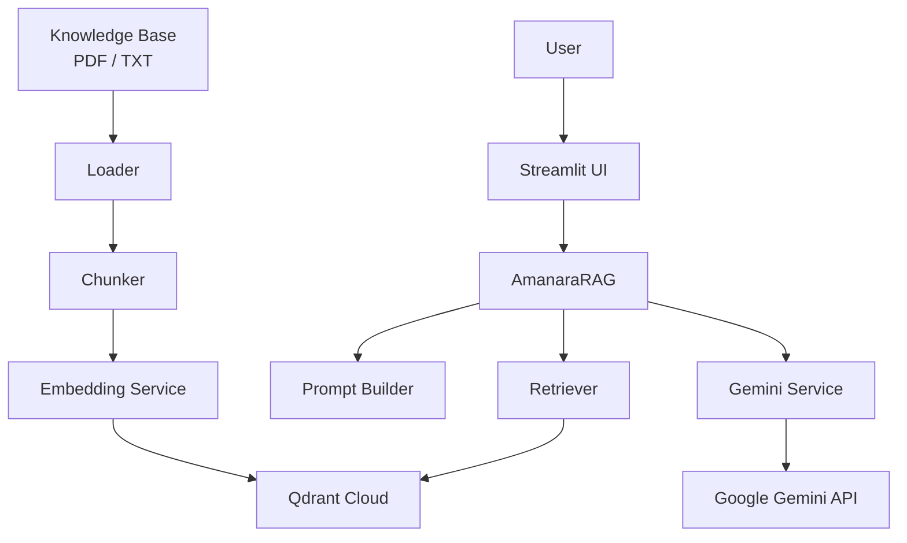

# Amanara AI RAG Chatbot

## Overview

Amanara AI is a Retrieval-Augmented Generation (RAG) chatbot developed to provide accurate, context-aware responses using a private knowledge base. The application combines Google Gemini, Qdrant Cloud, and a Streamlit interface to answer user queries based exclusively on uploaded documents.

Unlike a general-purpose AI assistant, Amanara AI retrieves relevant information from its knowledge base before generating a response, reducing hallucinations and improving answer reliability.

This project demonstrates the implementation of a production-style RAG pipeline, including document ingestion, semantic search, prompt engineering, vector storage, and conversational interaction.

## Features

- Retrieval-Augmented Generation (RAG) pipeline
- Google Gemini for response generation
- Google Gemini Embeddings for semantic search
- Qdrant Cloud as the vector database
- PDF and TXT document ingestion
- Automatic document chunking
- Semantic similarity search
- Streamlit-based conversational interface
- Conversation history
- Source document citations for responses
- Knowledge base upload and rebuild from the UI
- Environment-based configuration using `.env`

## System Architecture


## Project Structure

```text
amanara-chatbot/
│
├── assets/
│   └── logo.png
│
├── docs/
├── archive/
│
├── evaluation/
│   ├── evaluate_retrieval.py
│   ├── inspect_pdf.py
│   ├── list_chunks.py
│   ├── show_chunks.py
│   ├── test_chunker.py
│   ├── test_dataset.json
│   └── test_text_cleaner.py
│
├── knowledge_base/
│   └── Amanara_Company_Profile.pdf
│
├── scripts/
│   ├── create_collection.py
│   ├── list_models.py
│   ├── test_chatbot.py
│   ├── test_chunker.py
│   ├── test_embedding.py
│   ├── test_gemini.py
│   ├── test_ingestion.py
│   ├── test_loader.py
│   ├── test_prompt_builder.py
│   ├── test_qdrant.py
│   └── test_retriever.py
│
├── src/
│   └── amanara/
│       ├── api/
│       │   ├── chat.py
│       │   ├── health.py
│       │   └── router.py
│       │
│       ├── calculators/
│       ├── config/
│       │   └── settings.py
│       │
│       ├── core/
│       │
│       ├── memory/
│       │   └── conversation_memory.py
│       │
│       ├── models/
│       │   ├── chunk.py
│       │   └── document.py
│       │
│       ├── prompts/
│       │   └── prompt_builder.py
│       │
│       ├── rag/
│       │   ├── chatbot.py
│       │   ├── chunker.py
│       │   ├── ingestion.py
│       │   ├── loader.py
│       │   ├── retriever.py
│       │   └── text_cleaner.py
│       │
│       ├── services/
│       │   ├── embedding_service.py
│       │   ├── gemini_service.py
│       │   ├── intent_service.py
│       │   └── qdrant_service.py
│       │
│       ├── ui/
│       │   └── app.py
│       │
│       ├── utils/
│       ├── main.py
│       └── __init__.py
│
├── tests/
│   ├── test_chunker.py
│   └── test_text_cleaner.py
│
├── .env.example
├── .gitignore
├── .python-version
├── prompt.txt
├── pyproject.toml
├── README.md
├── requirements.txt
├── streamlit_app.py
└── uv.lock
```

### Directory Responsibilities

| Directory | Purpose |
|---|---|
| `src/amanara/api/` | FastAPI chat and health endpoints, plus API routing. |
| `src/amanara/config/` | Application settings and environment configuration. |
| `src/amanara/memory/` | Conversation-history management. |
| `src/amanara/models/` | Document and chunk data models. |
| `src/amanara/prompts/` | Prompt construction for LLM responses. |
| `src/amanara/rag/` | Document loading, text cleaning, chunking, retrieval, ingestion, and RAG orchestration. |
| `src/amanara/services/` | Gemini, embedding, intent, and Qdrant integrations. |
| `src/amanara/ui/` | Streamlit chatbot interface. |
| `scripts/` | Manual scripts for checking individual components and running ingestion. |
| `evaluation/` | Retrieval evaluation scripts and evaluation dataset. |
| `tests/` | Automated unit tests. |
| `knowledge_base/` | Approved documents used as the chatbot's retrieval knowledge base. |
| `assets/` | Logo and other application assets. |
| `docs/` | Project documentation. |
| `archive/` | Archived project files. |

### Root-Level Configuration Files

- `pyproject.toml` — Project metadata, runtime dependencies, development dependencies, and pytest configuration.
- `requirements.txt` — Exported runtime dependencies for deployment.
- `uv.lock` — Locked dependency versions for reproducible development.
- `.env.example` — Example environment-variable configuration without actual credentials.
- `.gitignore` — Excludes local secrets and generated files.
- `.python-version` — Specifies the intended Python version for the project.
- `streamlit_app.py` — Root-level Streamlit entry-point wrapper.
- `prompt.txt` — Project prompt configuration or instructions.
```
